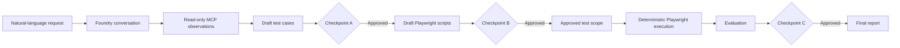

# Architecture

## Lifecycle

## Components

- `src/agents/`: Foundry-backed conversation and workflow orchestration.
- `src/workflows/`: validation, state transitions, approvals, test generation, script generation, evaluation, and repository evidence routing.
- `src/tools/github_mcp_adapter.py`: bounded read-only GitHub MCP evidence collection.
- `src/tools/playwright_mcp_adapter.py`: browser exploration observations for any browser-reachable target.
- `src/tools/playwright_runner.py`: deterministic Playwright Test execution for approved scripts only.
- `src/tools/repo_validator.py`: offline local repository inspection and command discovery; it never runs discovered commands automatically.
- `src/evaluators/`: rubric-based result evaluation.
- `src/models/`: Pydantic boundaries for requests, approvals, evidence, artifacts, results, and reports.

## Evidence Boundary

MCP and model responses are observations. They may inform test generation or evaluation, but cannot establish that a test passed, failed, or ran. Execution status is derived exclusively from the deterministic Playwright runner and its persisted output, traces, screenshots, and reports.

GitHub MCP has a fixed read-only allowlist: repository metadata, file contents, commits, issues, pull requests, and code search. It cannot write GitHub state. Playwright MCP remains disabled by default and never executes generated scripts.

## Approval Boundary

Checkpoint A approves test cases before scripts are generated. Checkpoint B approves a generated script before it is promoted and may be executed. Checkpoint C approves evaluation conclusions before recommendations can be acted on. Generated assets are immutable drafts; approved assets are traceable and can be considered for explicit compatibility-checked reuse.
